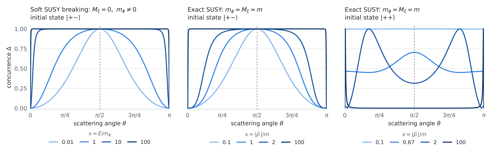

# Entanglement generated by the scattering of relativistic particles

*Entrelazamiento generado por la dispersión de partículas relativistas*

[](TFG_Mario_Cordoba_Burgueno.pdf)


**Mario Córdoba Burgueño**, supervised by **Carmelo Pérez Martín**<br>
Bachelor's thesis in Physics (TFG, code FT15), Departamento de Física Teórica, Universidad Complutense de Madrid, 2025–26

---

## Summary

How much entanglement does a scattering process create? This thesis studies $2 \to 2$ fermion scattering in the **Wess–Zumino model** in $d = 4$, the simplest supersymmetric quantum field theory. In the centre-of-mass frame the outgoing helicities form a pure **two-qubit state**, and its entanglement is measured with the **Wootters concurrence** $\Delta$.

Tree-level amplitudes are computed with **two-component Weyl spinors** (Dreiner–Haber–Martin conventions), both by hand and in Wolfram Mathematica. Three regimes are covered:

1. massless fermions and scalars;
2. **soft supersymmetry breaking** by a scalar mass;
3. the general massive case, with **exact** ($m_\phi = M_\xi$) and **broken** supersymmetry.

The results are compared with known QED results (Møller and Bhabha scattering, pair annihilation). QED has a very different interaction: a massless vector boson instead of massive scalars.

## Key results

<picture>
  <source media="(prefers-color-scheme: dark)" srcset="figures/concurrence_dark.png">
  
</picture>

- **Massless limit.** For opposite incoming helicities $|{+}{-}\rangle$ the final state is **maximally entangled** ($\Delta = 1$) at every scattering angle. For equal helicities $|{+}{+}\rangle$ it is a product state ($\Delta = 0$).
- **Maximal entanglement at $\theta = \pi/2$ at any energy.** For $|{+}{-}\rangle$, $\Delta(\pi/2) = 1$ for all masses and all energies. Møller scattering in QED shows the same behaviour.
- **Masses bring in angular dependence.** With soft breaking or exact supersymmetry, $\Delta \simeq \sin^2\theta/(1+\cos^2\theta)$ at low energy, and the massless result $\Delta \to 1$ is recovered at high energy.
- **$|{+}{+}\rangle$ with exact supersymmetry.** $\Delta \to 1$ at all angles at low energy and $\Delta \to 0$ at high energy, which reproduces the high-energy behaviour of QED.

Two structurally different theories, QED and Wess–Zumino, give the same maximal entanglement at $\theta = \pi/2$. This suggests the effect is not specific to QED.

<details>
<summary><b>Summary table: concurrence in each regime</b></summary>

High energy means $m/|\vec p\,| \to 0$ and low energy means $|\vec p\,|/m \to 0$.

| Regime | $\vert{+}{+}\rangle$, high E | $\vert{+}{+}\rangle$, low E | $\vert{+}{-}\rangle$, high E | $\vert{+}{-}\rangle$, low E | MaxEnt angle for $\vert{+}{-}\rangle$ |
|---|---|---|---|---|---|
| $m_\phi = M_\xi = 0$ | 0 | 0 | 1 | 1 | all $\theta$ |
| $M_\xi = 0,\ m_\phi \neq 0$ (soft breaking) | 0 | 0 | 1 | $\frac{\sin^2\theta}{1+\cos^2\theta}$ | $\pi/2$ |
| $m_\phi = M_\xi = m$ (exact SUSY) | 0 | 1 (all $\theta$) | 1 | $\frac{\sin^2\theta}{1+\cos^2\theta}$ | $\pi/2$ |
| $m_\phi \neq M_\xi,\ M_\xi \neq 0$ (broken SUSY) | – | – | – | – | $\pi/2$ |

</details>

## Method

The Wess–Zumino Lagrangian for one chiral supermultiplet (complex scalar $\phi$, Weyl fermion $\xi$):

```math
\mathcal{L}_{\mathrm{WZ}} = \partial^\mu\phi^*\partial_\mu\phi + i\,\xi^\dagger\bar\sigma^\mu\partial_\mu\xi - m_\phi^2\,\phi^*\phi - \tfrac{1}{2}M_\xi\left(\xi\xi + \xi^\dagger\xi^\dagger\right) - \tfrac{1}{2}\lambda\left(\xi\xi\phi + \xi^\dagger\xi^\dagger\phi^*\right)
```

For an incoming state $|h_1 h_2\rangle$, the outgoing helicity state is

```math
|f\rangle = \sum_{h_3,h_4=\pm} C[h_1h_2;h_3h_4]\,|h_3h_4\rangle,
\qquad
C[h_1h_2;h_3h_4] = \frac{1}{\mathcal{N}} \sum_{s,t,u} \mathcal{M}[h_1h_2;h_3h_4],
```

where $\mathcal{N}$ normalizes the state. Its entanglement is the concurrence

```math
\Delta = 2\,\bigl|\,C_{++}\,C_{--} - C_{+-}\,C_{-+}\bigr| \in [0,1].
```

The amplitudes add up the $s$-, $t$- and $u$-channel diagrams with scalar exchange, using explicit helicity spinors in the centre-of-mass frame.

## Repository contents

| File | What it is |
|---|---|
| [`TFG_Mario_Cordoba_Burgueno.pdf`](TFG_Mario_Cordoba_Burgueno.pdf) | Full thesis (in Spanish, abstract in English) |
| [`notebooks/1_scalar_mass_soft_susy_breaking.nb`](notebooks/1_scalar_mass_soft_susy_breaking.nb) | Massless fermion with scalar mass $m_\phi$: massless limit and soft SUSY breaking (thesis §4–5) |
| [`notebooks/2_massive_regime_initial_state_pm.nb`](notebooks/2_massive_regime_initial_state_pm.nb) | Fermion and scalar masses, initial state $\vert{+}{-}\rangle$: exact and broken SUSY (§6.1, §6.3) |
| [`notebooks/3_massive_regime_initial_state_pp.nb`](notebooks/3_massive_regime_initial_state_pp.nb) | Fermion and scalar masses, initial state $\vert{+}{+}\rangle$ (§6.2) |
| [`figures/make_concurrence_figure.py`](figures/make_concurrence_figure.py) | Python script that draws the figure above from the closed-form results (eqs. 44, 50 and 57) |

## Running the notebooks

1. Open any `.nb` file in Wolfram Mathematica.
2. Evaluate the cells in order. Running them step by step is recommended, since the notebooks follow the derivation and generate the limits and plots along the way.
3. To change the incoming helicities, edit the line

   ```mathematica
   l1 = 1/2; l2 = -1/2;
   ```

   for example `l2 = 1/2` for $|{+}{+}\rangle$.

All notebooks work for every mass limit. Comments and outputs are in Spanish.

## References

1. H. K. Dreiner, H. E. Haber and S. P. Martin, *Two-component spinor techniques and Feynman rules for quantum field theory and supersymmetry*, Phys. Rep. 494, 1 (2010). [doi:10.1016/j.physrep.2010.05.002](https://doi.org/10.1016/j.physrep.2010.05.002)
2. H. K. Dreiner, H. E. Haber and S. P. Martin, *From Spinors to Supersymmetry*, Cambridge University Press (2023).
3. J. Wess and B. Zumino, *Supergauge transformations in four dimensions*, Nucl. Phys. B 70, 39 (1974). [doi:10.1016/0550-3213(74)90355-1](https://doi.org/10.1016/0550-3213(74)90355-1)
4. W. K. Wootters, *Entanglement of formation of an arbitrary state of two qubits*, Phys. Rev. Lett. 80, 2245 (1998). [doi:10.1103/PhysRevLett.80.2245](https://doi.org/10.1103/PhysRevLett.80.2245)
5. A. Cervera-Lierta, J. I. Latorre, J. Rojo and L. Rottoli, *Maximal entanglement in high energy physics*, SciPost Phys. 3, 036 (2017). [doi:10.21468/SciPostPhys.3.5.036](https://doi.org/10.21468/SciPostPhys.3.5.036)
6. C. P. Martín, *Entanglement through high-energy scattering in noncommutative quantum electrodynamics*, Eur. Phys. J. C (2026). [doi:10.1140/epjc/s10052-026-15328-5](https://doi.org/10.1140/epjc/s10052-026-15328-5)

The full bibliography is in the thesis.

## How to cite

```bibtex
@thesis{cordoba2026entanglement,
  author      = {Córdoba Burgueño, Mario},
  title       = {Entanglement generated by the scattering of relativistic particles},
  type        = {Bachelor's thesis},
  institution = {Universidad Complutense de Madrid},
  year        = {2026},
  note        = {Supervisor: Carmelo Pérez Martín. In Spanish},
  url         = {https://github.com/cordoba87/Entanglement-generated-by-the-scattering-of-relativistic-particles}
}
```
